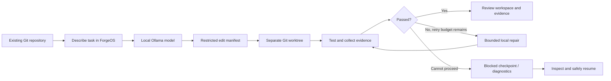

# ForgeOS

**A local-first AI software engineering workspace for turning plain-language development requests into traceable code changes, test results, and recovery checkpoints.**

[](https://github.com/DevTunaSoft/ForgeOS/actions/workflows/ci.yml)
[](https://github.com/DevTunaSoft/ForgeOS/actions/workflows/windows-exe.yml)


> [!IMPORTANT]
> **ForgeOS is under active development, not a production-ready autonomous application builder.** Its desktop application, local AI integration, Git workspaces, guarded code editing, diagnostics, and selected testing/recovery paths are real prototypes. Full hands-off delivery of arbitrary Windows EXEs, Android APKs and websites is a goal—not a current guarantee. Read the [feature status](#current-capabilities-and-limitations) and [security notes](#security-and-responsible-use) before using it on important projects.

**[What ForgeOS will and will not do](docs/PRODUCT_VISION.md) · [Get started](#quick-start) · [Detailed user manual](docs/USER_GUIDE.md) · [Architecture](docs/ARCHITECTURE.md) · [Windows EXE guide](docs/WINDOWS_BUILD.md) · [Roadmap](docs/ROADMAP.md) · [Multi-LLM implementation roadmap](docs/MULTI_LLM_ROADMAP.md) · [Contributing](CONTRIBUTING.md)**

## The vision

For a comprehensive, plain-English account of the **intended finished product, what exists today, limitations, and explicit non-goals**, read **[What ForgeOS Will Do — and What It Will Not Do](docs/PRODUCT_VISION.md)**. This is a product-scope explanation; the [user manual](docs/USER_GUIDE.md) remains the single source of step-by-step operating instructions.

Most AI coding tools still expect users to manage repositories, choose models, run commands, interpret failing tests, and manually resume interrupted work. ForgeOS aims to combine those steps in **one beginner-friendly desktop application**, prioritizing free local AI, explainable progress, recoverable edits, security controls, and efficient RAM usage.

**Today**, ForgeOS primarily works with an **existing local Git repository**, accepts a task in ordinary language, uses an installed Ollama model to plan or suggest edits, and provides a bounded edit/test/repair workflow. The application does **not** automatically merge, commit, push, deploy, or publish its generated work.

## How the current workflow fits together



The diagram describes the **implemented prototype path**, not an unattended production deployment. Test containment depends on platform, packaging, and preset; see below.

## Current capabilities and limitations

| Area | Available on `main` | Status / important limit |
| --- | --- | --- |
| Unified desktop interface | Tkinter Development and Activity & diagnostics tabs, task queue, test settings | Implemented prototype; not yet final design |
| Plain-language development | Task creation, Ollama planning, structured multi-file edit requests | Local Ollama must be separately installed and running |
| Git workspace safety | Per-task worktrees, edit validation, transactional edit journals | Generated edits stay available for manual inspection; no automatic publication |
| Test/repair cycle | Bounded retries, selected test presets, failure feedback | Not a universal build/test tool; security varies by runtime |
| Persistence and recovery | SQLite tasks, lease-fenced GUI/CLI planning/testing, edit recovery, checkpoint-aware resumption | Only eligible checkpoint phases can be resumed; never assume arbitrary crash recovery |
| Windows test isolation | Packaged EXE uses a fail-closed AppContainer runner for Python `unittest` and experimental bundled `pytest` | Other presets remain unsupported in the packaged secure runtime; hosted smoke does not prove real-PC security; see [Windows guide](docs/WINDOWS_BUILD.md) |
| Diagnostics | Raw evidence archives, SHA-256 checks, compact AI summaries, failure categories | Raw logs can include secrets; archive capacity and retention are bounded |
| Repair learning | Test-verified failure signatures, aggregated outcome statistics | Does **not** silently replay previous fixes |
| Model selection | Manual model choice and optional RAM-aware selection from installed Ollama models | No auto-download, paid API routing, or guaranteed minimum RAM |
| Memory management | Capped diagnostics, paged GUI history, streamed CLI history, on-demand process RAM report | Full process-tree/Ollama RAM and 4/8 GiB hardware acceptance not yet verified |
| Windows EXE packaging | GitHub Actions generates a PyInstaller `ForgeOS.exe`; hosted GUI and security smoke checks exist | Packaged CI checks are **not** real-user end-to-end desktop acceptance |
| GitHub operations inside ForgeOS | — | Planned, not implemented |
| Android APK / general web app builders | — | Planned, not implemented |
| Complete app export, encrypted backups, signed installer | — | Planned, not production-tested |

**Pull requests are not features on `main`.** The experimental packaged `python-pytest` AppContainer path has since been merged via PR #43 and passed hosted Windows smoke; the older PR #29 remains a separate unmerged proposal and must not be mistaken for another shipped feature. Physical Windows acceptance is still pending. Track the 52 proposed RTK-inspired outcomes in [RTK_ENHANCEMENTS.md](docs/RTK_ENHANCEMENTS.md) and the overlap audit in [ENHANCEMENT_DEDUP_AUDIT.md](docs/ENHANCEMENT_DEDUP_AUDIT.md).

## Experimental browser observation (review branch)

Issue [#65](https://github.com/DevTunaSoft/ForgeOS/issues/65) now has a **source-only, read-only browser observation prototype**. It does not run on startup, modify websites, use an LLM, attach to existing signed-in browser profiles, or add a required package dependency. The separate `browser` extra installs Playwright only when requested. The browser engine is launched for one observation and then closed.

For **developer evaluation only** on a public site (not a sensitive or authenticated session):

```powershell
py -m pip install -e ".[browser]"
py -m playwright install chromium
py -m forgeos.browser_probe https://example.com/ --allow-origin https://example.com
```

The probe reads a bounded list of page controls, omits input values and applies best-effort label redaction. It restricts requested origins, but Playwright routing does **not** reliably block every cross-origin redirect; this is **not** a browser network sandbox. No browser action agent, human takeover, LLM integration, GUI controls, measured token savings, packaged-EXE browser support or real-Windows acceptance is claimed. See [the browser section in the user guide](docs/USER_GUIDE.md#experimental-read-only-browser-observation-review-branch), the [architecture](docs/ARCHITECTURE.md), and [issue #65](https://github.com/DevTunaSoft/ForgeOS/issues/65). The normal ForgeOS install remains browser-free.

### Browsentic read-only connection (experimental review branch)

ForgeOS now has a **separate, opt-in, dependency-free connector** for the [Browsentic](https://github.com/imshaikot/browsentic) browser extension/Bridge, which can read a compact *page diagram* from a browser tab you are already using. It invokes the user-installed `browsentic mcp` process **only on explicit request**, verifies the approved tab's HTTPS origin before and after reading one resource, and then exits; it does **not** load Playwright, install Node, automate clicks, type text, submit forms, call an LLM or run in the desktop GUI. A separately approved **single scroll** is the first narrowly restricted action prototype. Normal ForgeOS installs are unaffected.

After independently reviewing and installing Browsentic and pairing its extension, the **developer-only** command is:

```powershell
py -m forgeos.browsentic_readonly --allow-current-tab --allow-origin https://github.com
```

To perform **one scroll down** on a safe public tab, use a separate command that explicitly authorizes that action:

```powershell
py -m forgeos.browsentic_readonly --allow-current-tab --allow-origin https://example.com --scroll-direction down --approve-scroll
```

For a **changes-only** result after the scroll, add `--changes-only`:

```powershell
py -m forgeos.browsentic_readonly --allow-current-tab --allow-origin https://example.com --scroll-direction down --approve-scroll --changes-only
```

This reads two bounded snapshots in the same invocation and prints only the sanitized lines that appeared or disappeared from the visible page diagram. It retains **no page history** after the command exits, and rechecks the approved tab between reads. The compact formatter scans input line-by-line instead of allocating thousands of split lines. UTF-8 byte-limit validation also avoids allocating a full-size copy for ASCII pages and uses 1,024-character chunks for Unicode pages. Reproducible **synthetic** allocation and output-size budgets are checked on Windows and Linux CI with `python tools/browser_observation_benchmark.py --check`. The benchmark measures **characters and Python allocations**, not genuine LLM tokens, real browser RAM or total process-tree memory.

The approved action list contains **only** up/down/top/bottom scrolling, performed once. It never enables clicking, typing, navigation, form submission, or unattended AI actions. Scrolling can still trigger page scripts or network requests. This one-shot prototype is NOT an autonomous browser agent or a substitute for approval-gated GUI actions.

**Security:** The active tab might contain private data; only run this after inspecting the selected tab. The connector never sends its output to AI automatically, limits resource size to 48 KiB and displayed content to 2,400 characters, and suppresses whole labels that resemble credentials (including multiword passwords, bearer tokens, JWTs and common personal identifiers). Email addresses are masked. These checks run on at most 1,024 characters per label and **cannot guarantee** removal of every secret. Suppression can also hide some otherwise useful page labels. Browsentic's MCP client can ordinarily access additional capabilities, but ForgeOS currently calls only the read-only `browsentic_status` tool (before and after) and `browsentic://page/diagram` resource; do not set `guardrails.unattended: "allow"`. Browsentic's own security docs say that another program running as your OS user can control an already paired browser. The origin/tab check is not atomic and cannot rule out every concurrent tab switch. The unit suite also exercises stdio against a temporary simulated MCP subprocess on Windows/Linux CI; this does not establish real Browsentic compatibility. Real Browsentic/Windows/EXE browser behavior and token savings have **not yet been verified**. See the [user manual](docs/USER_GUIDE.md#experimental-browsentic-read-only-connection-review-branch) and [issue #65](https://github.com/DevTunaSoft/ForgeOS/issues/65).

### Windows Browsentic acceptance harness (experimental)

The **optional, stdlib-only Windows acceptance harness** tests the existing browser connection against a **public, non-sensitive page** in your paired Chrome/Edge tab. It launches the existing ForgeOS Browsentic CLI once, checks only a bounded response, and exits. It does **not** install Browsentic, run unattended browser actions, poll in the background, or make model calls.

```powershell
py -m forgeos.browser_acceptance --allow-origin https://example.com --confirm-public-test-tab
```

The result is a small JSON object containing PASS/BLOCKED/FAIL, elapsed time, output character count, and sampled Windows working-set memory of the launched ForgeOS CLI and its descendants. **It never prints or stores page text, page URLs, browser titles, or raw MCP errors. The acceptance runner's child stdout is drained in fixed 1 KiB chunks and stops immediately above a 4 KiB capture budget; it no longer uses `communicate()` to buffer untrusted output without limit. Failure and timeout paths terminate the temporary child tree without browser-action retries.** An opt-in `--external-pid 1234` argument (repeat up to twice) can also sample the independently running Browser/Bridge process trees; these values are reported *separately*, never added, to avoid accidental double counting. Use the PID shown in Windows Task Manager's **Details** tab. Do not interpret missing samples as zero memory.

This is **not** verification that a browser is installed or paired: a real Windows test must still be performed by an operator. Tests in GitHub CI use mocked connections and a native Windows process-memory probe, not a real Browsentic installation. See the [user guide](docs/USER_GUIDE.md) for full steps and scope.

## Quick start

### Option A — use the packaged Windows prototype

1. Open [Actions → Windows executable](https://github.com/DevTunaSoft/ForgeOS/actions/workflows/windows-exe.yml).
2. Open a **successful workflow run on the branch you intend to use**.
3. Download the `ForgeOS-Windows-EXE` artifact; extract the ZIP and run `ForgeOS.exe`.
4. Have **Git** installed for workspace operations and **Ollama + an installed local model** if you want AI planning/editing. These tools and model weights are **not** bundled.
5. Start with a **disposable Git repository** that you can safely test.

An Actions artifact is a development build, **not a signed production installer or official release**. Artifacts are retained for 14 days. See [Windows EXE guide](docs/WINDOWS_BUILD.md) for precise build and acceptance limitations.

### Option B — run from source (Windows PowerShell)

Requires **Python 3.10+** and **Git**. Ollama is optional for opening the UI and mandatory for AI features.

```powershell
git clone https://github.com/DevTunaSoft/ForgeOS.git
cd ForgeOS
py -m pip install -e .
py -m forgeos gui
```

Using the GUI:

1. Under **Project repository**, browse to an **existing local Git repository**.
2. Type a specific development task under **Tell ForgeOS what to build**.
3. Select **Add task**, then select the task in the queue.
4. Choose a local model (or `auto`), a test preset, and a workspace folder.
5. Use **Generate plan** for planning. Enable **Host test execution** only for a trusted repository before selecting **Run tests only** or **Build / test / repair**. Both test operations use the same guarded runtime selection.
6. Review results in **Activity & diagnostics**, then inspect the generated Git worktree before accepting changes.

**Source/development mode:** generated project tests may run on your computer after explicit host-execution permission. **Do not opt in for untrusted code.** Packaged Windows runtime restrictions are described in [Security and responsible use](#security-and-responsible-use).

Full screenshot-free, click-by-click instructions: [User manual](docs/USER_GUIDE.md).
You can also open it **offline inside ForgeOS** via **Activity & diagnostics → How to use ForgeOS**. The EXE embeds this same canonical guide (not a second manual).

## Command-line workflows

```powershell
py -m forgeos add C:\path\to\existing-repo "Fix startup error"
py -m forgeos list
py -m forgeos plan 1 --model auto
py -m forgeos test 1 --preset python-unittest --allow-host-tests
py -m forgeos recover
py -m forgeos memory
py -m forgeos diagnostics stats
py -m forgeos learning stats
py -m forgeos filters status
```

To run the autonomous edit/test/repair **source-mode** prototype against a trusted repository:

```powershell
py -m forgeos run 1 --workspace-parent C:\forgeos-work --model auto --preset python-unittest --allow-host-tests
```

Create the workspace parent folder before running this CLI command. The `--allow-host-tests` flag is also required for the CLI's standalone `test` action. It permits trusted source-mode test execution; **it is not a declaration that the host is fully sandboxed**. In the packaged Windows application, designated Python test presets use the fail-closed AppContainer path. The standalone manual test operates on the selected original repository, not ForgeOS's generated worktree, and will not overwrite a passed or blocked task.

CLI and GUI planning/testing now use the same SQLite task lease and status-transition checks, instead of separate implementations. This reduces the risk of concurrent operations overwriting each other's results; physical Windows crash/restart acceptance remains outstanding.

Supported CLI recovery commands also include `resume-safe`, `run --resume` and `recover-edits`, with strict workspace/checkpoint validation. Read the [manual](docs/USER_GUIDE.md#6-recovery-after-an-interruption) before using them.

## Experimental local multi-model support (review branch)

ForgeOS originally used **Ollama only**. The multi-model feature branch adds
dependency-free **loopback OpenAI-compatible adapters** for llama.cpp, LM Studio
and configurable local servers, while preserving Ollama and the existing
RAM-aware selector. The same ForgeOS GUI now offers a backend selector, local
endpoint field and **experimental Hugging Face GGUF catalog and verified weight downloader**. This is
an **experimental implementation with hosted CI passing, but real-runtime acceptance pending**, not a verified
local model installer or unified native inference engine.

The Hugging Face browser can search public GGUF repositories, inspect file
sizes and hashes, and **download and verify** selected GGUF weights on
demand. Downloads are pinned to an immutable revision, hashed with SHA-256,
resumable after interruption and published atomically if verification passes.
The feature branch implements single-server unexpected-exit detection and fail-closed credential cleanup without extra background timers, as well as a **pinned official Windows x64 CPU llama.cpp
runtime installer**, now available from the existing **Run verified local GGUF**
dialog via **Install verified official Windows CPU runtime (opt-in)**. It downloads
only on explicit confirmation, verifies the pinned ZIP and all bundled binaries
and DLLs against that archive, and never silently executes an installer script,
runs Docker, or downloads weights. Select a ForgeOS SHA-verified GGUF and click
**Start installed CPU runtime**: the entire installed runtime bundle is verified
again immediately before the existing authenticated, localhost-only server
starts. **Start manual runtime** remains available for independently trusted,
SHA-pinned user-provided binaries. The frozen EXE does **not** bundle
llama-server, DLLs, or models; this experimental path has regression/hosted CI
evidence, **not yet real Windows/GGUF end-to-end acceptance**. Native DLL
load-time mutation and port/process-ownership races remain open release risks.

External llama.cpp, LM Studio or other compatible servers may still be
used through the existing local endpoint adapters.

Read the [model compatibility and setup guide](docs/MODEL_COMPATIBILITY.md)
for clear statuses, CLI examples and security boundaries. The
[complete multi-LLM engineering roadmap](docs/MULTI_LLM_ROADMAP.md) tracks all
required model management, memory governance, routing, recovery, QA, beginner GUI
and documentation work as implemented, experimental, unverified or planned.

## Local AI and memory efficiency

ForgeOS currently targets **Ollama at 127.0.0.1:11434**; it does not require a paid AI subscription or send code to a cloud model as part of this route. The selected Ollama model must already be installed. Automatic selection considers installed model names, approximate file sizes and available RAM, but **file size is not a runtime memory guarantee**.

The project includes disk-backed output capture, bounded UI previews, SHA-256 evidence references, a 150-task GUI page size and an on-demand working-set report. Process RAM telemetry does **not** include external Ollama, compilers or GPU allocations. The 4 GiB lightweight-interface and 8 GiB small-model scenarios are **engineering targets, not verified minimum system requirements**. See [Memory budget](docs/MEMORY_BUDGET.md).

## Experimental packaged pytest test isolation (PR #43)

ForgeOS includes **experimental packaged** `python-pytest` support using the
same restricted Windows AppContainer as `python-unittest`, with no host
execution fallback for those supported presets.
The Windows EXE build installs pytest as an **optional packaging extra**,
not a mandatory dependency for the lightweight core. The frozen child writes
pytest's log file into a monitored disposable snapshot, avoiding its default
Windows NUL device behavior (blocked in the original PR #29 smoke).
The secure pytest feature has passed the hosted Windows frozen-executable
unittest/pytest AppContainer smoke, four Python matrix checks and GUI package
acceptance in PR #43. That does not verify every physical Windows machine;
other frozen test presets remain fail-closed.

## Security and responsible use

- Generated code is **untrusted**. In source mode, enable host tests only for trusted repositories you are willing to execute locally.
- The frozen Windows executable has a **fail-closed AppContainer** path for its supported `python-unittest` and experimental `python-pytest` presets, including the manual test action. It does not automatically extend to other frameworks. **No Docker required.**
- ForgeOS validates edit paths and limits the size and count of generated file replacements. Isolated Git worktrees and transaction journals help keep changes reviewable and recoverable, but they are not an all-purpose security sandbox.
- **Raw diagnostic logs are sensitive and stored locally without at-rest encryption**. Do not include credentials in tasks, upload the evidence store or publish it in a handoff.
- Do not treat a green build badge, synthetic GUI test or hosted Windows smoke test as proof of safe unattended app building on a real user PC.

For additional detail, see [Architecture & trust boundaries](docs/ARCHITECTURE.md).

## Release readiness

ForgeOS remains **experimental** until it passes interactive Windows validation for GUI startup, real local Ollama calls, actual generated edit/test/repair cycles, crash recovery, isolation, and full process-tree memory behavior on representative machines. [GitHub Actions](https://github.com/DevTunaSoft/ForgeOS/actions) provides essential CI and packaged checks, but does not replace those real-user acceptance tests.

The [roadmap](docs/ROADMAP.md) distinguishes completed prototypes from work still needed. PRs and CI should provide evidence before changing a feature's status to verified.

## Documentation and project continuity

Documentation is part of the development deliverable. Each substantive change should update applicable user instructions, capability status, architecture/security notes, roadmap and [engineering handoff](docs/HANDOFF.md). The repository includes a [documentation policy](docs/DOCUMENTATION_POLICY.md), [contribution checklist](CONTRIBUTING.md) and automated documentation checks.

Detailed sources: [Product requirements](docs/REQUIREMENTS.md) · [Project roadmap](docs/ROADMAP.md) · [Architecture](docs/ARCHITECTURE.md) · [User guide](docs/USER_GUIDE.md) · [Windows build](docs/WINDOWS_BUILD.md) · [Memory testing](docs/MEMORY_BUDGET.md) · [52 enhancements](docs/RTK_ENHANCEMENTS.md) · [Deduplication audit](docs/ENHANCEMENT_DEDUP_AUDIT.md) · [Engineering handoff](docs/HANDOFF.md).

## Contributing and feedback

Development happens openly at [DevTunaSoft/ForgeOS](https://github.com/DevTunaSoft/ForgeOS). Before proposing a change, read [CONTRIBUTING.md](CONTRIBUTING.md). Bugs and reproducible test failures can be reported through [GitHub Issues](https://github.com/DevTunaSoft/ForgeOS/issues); include non-sensitive reproduction steps and your OS/runtime, **not** passwords or raw logs with private data.

*License: no repository license is currently published. Do not assume the code is open-source-licensed merely because it is publicly readable.*


### Further model-management work

The draft branch now includes a **bounded offline inventory** of existing
Hugging Face GGUF downloads, available from **Run verified local GGUF →
Choose from ForgeOS downloads** and through `forgeos models-local`.
`forgeos model-verify-local <path>` streams an explicit SHA-256 recheck
without loading the model. Listing metadata is not equivalent to
reverification; the managed runtime rehashes before launching.
Full native binary/model installation, imported GGUF management, update,
uninstall and intelligent model switching remain open roadmap milestones.

**Optional cloud models are on the roadmap, not yet integrated**:
OpenAI/ChatGPT, Anthropic/Claude and other approved endpoints will require
explicit consent and spending/privacy controls. ForgeOS does not assume
free ChatGPT or Claude consumer accounts provide free API access.


**Experimental process containment (PR #51):** the managed CPU llama-server
now attaches to a Windows Job Object configured to terminate the owned
process tree when closed; Linux/POSIX uses an owned process session.
The short interval between process creation and Windows Job assignment,
listener/process authentication, direct GGUF execution on real hardware
and clean cancellation of all native child processes remain unaccepted.
The generated project-test AppContainer is a separate trust boundary.


### Latest multi-LLM GUI integration verification (experimental branch)

On 2026-11-08, feature commit `c541041926c6c726e7fa034f6591318188bd2a17` passed all six required hosted checks: four Linux/Windows Python 3.10/3.12 test jobs, documentation integrity, and Windows EXE packaging (18,524,708 bytes), including frozen GUI and secure AppContainer smoke. The suite executed **349 tests per platform run** (with OS-specific skips). An **offline real POSIX subprocess/loopback integration test** now verifies process startup, authenticated model-style HTTP, request output, and cleanup using a tiny local fake server, **not a real llama.cpp runtime or GGUF inference**. Production/real-Windows acceptance remains open; PR #51 is draft and unmerged.


### GGUF download interruption recovery (experimental branch)

Cached GGUF weights now need a matching pinned identity manifest before success is reported. Interrupted model publication can safely recreate a missing manifest after a full SHA-256 and GGUF header check without a second weight download. Conflicting manifests, journals and stray partial files are preserved and rejected. Windows reserved device filenames are rejected. See the recovery guidance in docs/USER_GUIDE.md. Real Windows and multi-gigabyte acceptance remain pending.


### Pausing and resuming a large GGUF download (experimental PR #51)

In the existing Hugging Face browser, the **Pause download** button cooperatively stops a transfer and retains the checked revision's partial bytes and journal. A later request for the same repository/weight revision resumes via an exact HTTP range and rechecks the final SHA-256. Download progress and the separate final SHA-256 verification phase are shown without keeping giant data or event queues in RAM. Closing the model browser while a transfer is active requests pause and closes only after the worker acknowledges. A network read can remain blocked for up to its configured timeout, so pause is not instantaneous. No background downloader, Docker, cloud inference, or new desktop app was added.


The experimental managed GGUF server additionally caps manually requested context to the current system RAM profile and performs a second memory-budget check immediately before native inference startup, after hashing the GGUF and runtime. These safeguards reject some memory pressure but do not replace native process RAM monitoring or proven low-memory Windows benchmarks.


**Latest experimental branch CI checkpoint (Nov 8, 2026):** `37af510c` passed six hosted checks, including 365 regression tests inside Windows packaging and frozen GUI/AppContainer smoke. A real Windows 11 session with a verified GGUF and llama.cpp must still be tested before this PR can be called release-ready.


### Recoverable local GGUF model retirement (experimental)

The CLI can now retire one locally SHA-verified GGUF without deleting its bytes, and later restore it from an ID. Use the existing model folder: run python -m forgeos models-local, then python -m forgeos model-retire-local "ABSOLUTE_PATH.gguf" --confirm. Run python -m forgeos models-retired to list recovery IDs; run python -m forgeos model-restore-local "RETIREMENT_ID" to recover. Pass --directory PATH for alternate local model storage. All model moves use the existing download lock and pinned SHA-256 manifest. A durable journal supports crash-interrupted file moves. **Retirement retains the weight bytes on disk and does not free space.** Stop any actively running model first. Physical Windows process-in-use and abrupt power-failure testing remain unverified.


The same recoverable retirement action is available in the existing desktop Manage local GGUF > Choose from ForgeOS downloads picker. It is disabled while ForgeOS is performing a task or owns a managed model process; a worker thread performs the full SHA-256 recheck, and the recovery ID is shown on completion.


The existing managed GGUF window can now **restore a retired model** using the same verified journal as the CLI. Restoration is explicit, offline, and non-overwriting; the worker hashes weights without blocking the Tk interface. Retirement/restoration additionally rejects hard-linked model or manifest files to avoid manipulating bytes also accessible outside the model directory.

### Live task activity (experimental)

The **Activity & diagnostics** tab now shows the active task ID, operation, elapsed seconds, and current persisted task stage (planning, editing, testing, blocked, passed, or failed). Stage changes are appended to the bounded diagnostic log. The monitor reuses the GUI's existing event loop and reads the task database at most once per second; it does not start a second polling worker. **Editing** includes both workspace setup and waiting for model output: token-level model progress and subprocess output are not yet streamed. Test results and errors appear when the worker finishes. The monitor does not continue execution after ForgeOS exits.

**Recovery limitation:** The existing **Resume safe blocked tasks** action handles structured test/repair checkpoints, not early model-generation timeouts. Do not create duplicate tasks or delete workspaces to work around a blocked generation task. A guarded pre-edit retry path remains planned and is not yet implemented.
