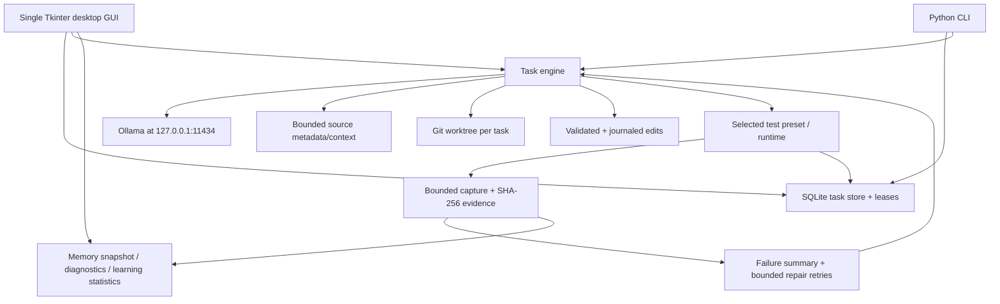

# ForgeOS architecture and trust boundaries

**Document status:** source-backed overview of the current `main` prototype. It does not represent a completed production-security review.

## System overview

## Canonical modules

| Source | Responsibilities |
| --- | --- |
| `src/forgeos/gui.py` | Tkinter application, two tabs, queue paging, on-demand evidence displays, worker/thread handoff |
| `src/forgeos/cli.py` | Scriptable commands for tasks, testing, recovery, diagnostics, memory, filters and learning |
| `src/forgeos/core.py` | SQLite task state, leases, local Ollama connector, test orchestration primitives |
| `src/forgeos/engine.py` | Edit constraints, structured prompt/edit manifest, bounded local task cycle, checkpoint validation and chosen test-runtime routing |
| `src/forgeos/task_actions.py` | Canonical lease-fenced planning and manual-test operations reused by CLI and GUI; requires explicit trust opt-in for tests |
| `src/forgeos/workspace.py` | Git repository/worktree setup and ownership |
| `src/forgeos/transactions.py` | Transactional edit journal, streamed bounded original-file backups (8 MiB/file), failure/rollback/recovery boundaries |
| `src/forgeos/recovery.py` | Eligible checkpoint resumption and safe recovery workflow |
| `src/forgeos/test_runtime.py` | Disposable runtime snapshots and cleanup |
| `src/forgeos/secure_runner.py`, `appcontainer.py`, `windows_containment.py`, `sandbox_runner.py` | Frozen Windows execution containment |
| `src/forgeos/diagnostics.py`, `output_capture.py`, `output_rules.py` | Evidence archive, bounded output, summaries, trusted filters |
| `src/forgeos/error_learning.py`, `optimizer_metrics.py`, `insights.py` | Test-verified repair signatures, efficiency and advisory diagnostic views |
| `src/forgeos/context_index.py` | Bounded, relevance-ranked file/symbol metadata for prompts |
| `src/forgeos/model_routing.py` | Installed Ollama model routing, local memory preflight and one-shot process memory report |
| `forgeos_build/launcher.py` | Frozen Windows executable launcher and CI acceptance modes |
| `tests/` | Regression, recovery, security, GUI, diagnostics and memory tests |
| `.github/workflows/` | Python CI and Windows packaged smoke/acceptance |

**Do not fork duplicate implementations of these capabilities** without first checking existing ownership and the [deduplication audit](ENHANCEMENT_DEDUP_AUDIT.md).

## Workflow and state

1. A user adds a task referencing an existing local Git repository. The optional GUI/CLI **Plan** and **Run tests only** actions now share `task_actions.py` instead of using independent, unguarded SQLite state writes. Direct tests require explicit host-test permission and use the engine's platform-specific test containment (frozen Windows supported presets only).
2. ForgeOS persists it in SQLite; leases protect concurrent task ownership, including CLI planning and the autonomous edit/test/repair cycle. The engine now uses lease-fenced, compare-and-set updates for each checkpoint, completion, failure and blocked state; stale workers cannot publish after their lease expires or is reclaimed.
3. A local installed Ollama model provides a plan or a bounded, JSON-defined file-edit manifest.
4. ForgeOS validates file paths, extensions and total edit budget before writing; a transaction journal supports recovery.
5. Changes are written to a **separate Git worktree**, not automatically merged into the user's original branch.
6. A selected test preset executes through an environment-dependent runtime.
7. Bounded output capture feeds original evidence and a smaller AI-facing summary into a limited repair loop.
8. A result or blocked checkpoint preserves the workspace so a person can inspect it. Automatic commit/push/merge/deploy is **not** enabled.

The task engine does not hold an operating-system filesystem lock while generating/editing: a lease may expire during a long-running external call. Lease fencing prevents stale *database publications*, but a worktree touched before detecting the expired lease still requires careful inspection; recovery must not silently overwrite it.

Checkpoint recovery is deliberately narrow; file hashes, workspace ownership, branch and saved execution parameters must match. Not all interrupted phases can resume. `resume-safe` reads only blocked checkpoint fields through SQLite keyset pages of 16 records; any checkpoint over 64 KiB is reported as skipped without loading its payload into Python. It does not scan completed-task test output or bypass execution leases.

## Execution security: differentiate the environments

| Environment | Present behavior | Security implication |
| --- | --- | --- |
| Source/development mode | May run project tests after explicit host-test opt-in; Windows dev mode has additional lower-integrity snapshot behavior in some paths | **Not a reliable untrusted-code sandbox.** Only run trusted projects |
| Frozen Windows EXE, `python-unittest` | Packaged in-process child is launched with AppContainer + Job Object and disposable snapshot; fail-closed on unsupported/failed isolation | Tested in hosted CI smoke, but not proven across real-world installs |
| Pytest file-logging boundary | Parent validates owned `.forgeos-runtime/pytest-log.txt`, monitors it and `test-output.txt` at 500 ms intervals (32 MiB/file); force-fail on link substitution/disk overflow | Normal logging/caplog plugin remains enabled, third-party plugin autoload disabled; hosted CI passed, user-hardware acceptance pending |
| Frozen Windows EXE, other presets on `main` | Not all supported in the secure runner; unsupported runtimes fail closed | Do not bypass containment to make tests pass |
| Frozen Windows `python-pytest` (PR #43) | Bundles optional pytest, invokes a hidden frozen child, keeps logging inside a snapshot-owned watched file and uses the same AppContainer + Job Object | **Implemented experimental; hosted Windows unittest+pytest secure smoke passed**, physical end-user validation outstanding |

Docker is **not required**. Git worktrees are version-control isolation, not operating-system security isolation. No test runner is allowed to claim full untrusted-code containment without real runtime proof.

## Sensitive data and storage

- `~/.forgeos/tasks.sqlite3`: task descriptions, results, checkpoints and status.
- Evidence archives: original local test logs keyed by SHA-256; **not encrypted at rest**, may contain secrets.
- `~/.forgeos/output_filters.json`: optional local literal filter configuration. Content-hash trust pinning detects changes but does not protect against a malicious same-user process.
- `~/.forgeos/` may also include model/learning/metrics-related local state.
- Separate Git worktrees: generated changes and potentially sensitive project files.

Avoid writing secrets into descriptions or test output; never attach the raw evidence directory to a public GitHub issue, release or project handoff. Reliable encrypted backup/restore and user-oriented retention controls remain future work.

## Performance and memory

Memory design focuses on bounded memory in **ForgeOS itself**: paginated task list, capped GUI history, disk-spooled output with size limits, bounded context and incremental CLI listing. The RAM probe reports ForgeOS's own process working set, **not** Ollama weights, GPU RAM or child build processes. Current 4/8 GiB system targets remain unverified. See [MEMORY_BUDGET.md](MEMORY_BUDGET.md).

## Verification and shipping gates

The workflow suite includes Python regressions, Windows EXE packaging, frozen GUI startup/cleanup checks, synthetic 520-task paging acceptance and a packaged AppContainer boundary smoke. These prove specific conditions on GitHub-hosted runners; they do **not** establish a safe unattended workflow on a real Windows desktop.

Before a release claim: run end-to-end with real local model(s), edit/test/repair, restart/crash recovery, appropriate OS execution isolation, representative memory/hardware configurations, usability and safe distribution checks. Record failures and results in [HANDOFF.md](HANDOFF.md) and update the [roadmap](ROADMAP.md).

## Intended evolution

Future capabilities include beginner-friendly project creation, broad runtime/build adapters, GitHub PR workflows inside ForgeOS, multi-model agent roles, richer fuzz and fault injection, hardware acceptance and full source/handoff export. These must integrate with the canonical modules above rather than duplicate them, and must stay visibly labeled **planned/in progress** until evidence supports implementation.

## Large recovery reports

The CLI offers `resume-safe --stream-report` as an optional JSON Lines
stream. This reuses the canonical checkpoint validator/orchestrator and
avoids collecting an unbounded per-task outcome list in Python memory.
Default `resume-safe` output remains a complete backward-compatible JSON
report. Each streamed task is followed by one final count summary, and
failure exit status is retained. An interrupted process may have emitted
partial lines without a summary; never treat such output as success.
