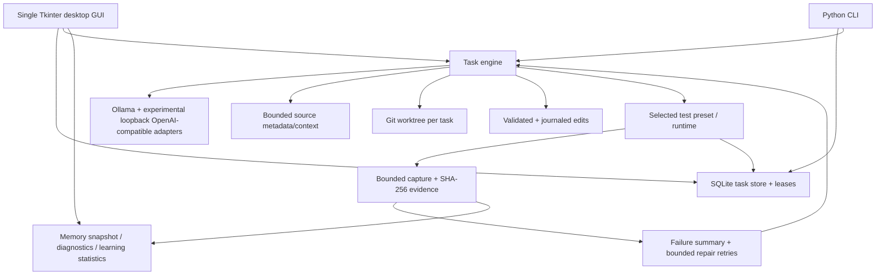

# ForgeOS architecture and trust boundaries

**Document status:** source-backed overview of the current `main` prototype. It does not represent a completed production-security review.

## System overview

## Canonical modules

| Source | Responsibilities |
| --- | --- |
| `src/forgeos/gui.py` | Tkinter application, two tabs, queue paging, on-demand evidence displays, worker/thread handoff |
| `src/forgeos/cli.py` | Scriptable commands for tasks, testing, recovery, diagnostics, memory, filters and learning |
| `src/forgeos/core.py` | SQLite task state, leases, local Ollama connector, test orchestration primitives |
| `src/forgeos/engine.py` | Edit constraints, structured prompt/edit manifest, bounded local task cycle, checkpoint validation and chosen test-runtime routing |
| `src/forgeos/portable_names.py` | Canonical Win32 device-stem and trailing dot/space predicates shared by the edit engine, the GGUF downloader and the runtime installer; each caller keeps its own exception type |
| `src/forgeos/task_actions.py` | Canonical lease-fenced planning and manual-test operations reused by CLI and GUI; requires explicit trust opt-in for tests; failure bookkeeping never masks the triggering error |
| `src/forgeos/workspace.py` | Git repository/worktree setup and ownership |
| `src/forgeos/transactions.py` | Transactional edit journal, streamed bounded original-file backups (8 MiB/file), failure/rollback/recovery boundaries |
| `src/forgeos/recovery.py` | Eligible checkpoint resumption and safe recovery workflow; bounded reason text and streaming event reporting |
| `src/forgeos/test_runtime.py` | Disposable runtime snapshots and cleanup |
| `src/forgeos/secure_runner.py`, `appcontainer.py`, `windows_containment.py`, `sandbox_runner.py` | Frozen Windows execution containment |
| `src/forgeos/diagnostics.py`, `output_capture.py`, `output_rules.py` | Evidence archive, bounded output, summaries, trusted filters; Windows evidence temp allocation fails fast rather than retrying indefinitely on denied storage |
| `src/forgeos/worktree_manifest.py` | Database-free, bounded regular-file worktree hashing and exact manifest verification; excludes operational metadata and rejects links/reparse points |
| `src/forgeos/error_learning.py`, `optimizer_metrics.py`, `insights.py` | Test-verified repair signatures, efficiency and advisory diagnostic views |
| `src/forgeos/context_index.py` | Bounded, relevance-ranked file/symbol metadata for prompts |
| `src/forgeos/model_routing.py` | Installed Ollama model routing, local memory preflight and one-shot process memory report |
| `src/forgeos/local_models.py` | Experimental loopback-only chat adapter for llama.cpp, LM Studio and configurable local OpenAI-style endpoints; bounded requests/responses, no proxy/redirects |
| `src/forgeos/huggingface_catalog.py` | Opt-in public GGUF metadata, pinned commit revision, hash/size inspection |
| `src/forgeos/gguf_download.py` | Experimental pinned and SHA-256-verified resumable GGUF downloader, native per-target lock, disk budget and atomic publication; does not execute model weights |
| `forgeos_build/launcher.py` | Frozen Windows executable launcher and CI acceptance modes |
| `tests/` | Regression, recovery, security, GUI, diagnostics and memory tests |
| `.github/workflows/` | Python CI and Windows packaged smoke/acceptance |

**Do not fork duplicate implementations of these capabilities** without first checking existing ownership and the [deduplication audit](ENHANCEMENT_DEDUP_AUDIT.md).

### Transaction journal filesystem boundary

The edit journal lives under `workspace/.forgeos/pending-edit`. Before any
journal read, write or cleanup, ForgeOS requires both internal directories to
be real directories. POSIX symlinks and hard-linked journal files are rejected;
on Windows, the same metadata check also rejects filesystem reparse points such
as junctions. The manifest and streamed backup files must be unlinked regular
files, so a redirected or shared journal fails closed without reading or
deleting outside the worktree. On POSIX, the internal directories are forced to
mode `0700`, while manifests, backups and restore temporaries are created with
mode `0600`; staged replacement files retain the historical umask-derived mode
because they become published workspace files. Windows leaves ACL behavior
unchanged and retains the operator ACL-review boundary. Recovery continues to
open regular journal files and edit targets through bounded descriptors with
initial `lstat`, opened-handle identity and post-read/copy checks. POSIX uses
`O_NOFOLLOW` when available; Windows also compares opened-handle metadata and
rejects reparse identities. Hashing and copying remain bounded to 64 KiB
chunks, and POSIX journal-directory removal is flushed after cleanup.

This closes the path-substitution window while a regular file is being opened,
hashed or copied. Journal cleanup is bounded to the allowlisted flat files a
transaction can create; unexpected, linked or directory children are rejected
and preserved rather than recursively traversed, with file and directory
identity rechecks before removal. Atomic target publication still has a
check-and-use race boundary, but publication now revalidates every real parent
directory, the target identity, and the staged and published digests before
and after replacement. Cleanup and publication are not a complete
concurrent-writer lock. This is not a Windows DACL boundary or physical NTFS
power-loss acceptance. Operators should preserve an unsafe journal for
inspection and resolve the filesystem problem before retrying recovery.

Rollback recovery copies use the same private-temporary boundary: the real
target parent is captured before copying, the POSIX temporary descriptor stays
open through a failed replacement decision, and Windows compares the file
identity without holding a handle that could block `os.replace`. A substituted
rollback temporary is preserved for inspection rather than removed by the
recovery `finally` path.

Rollback deletion of a newly created target and cleanup of flat journal
children use the same identity-bound removal boundary. The original file and
real parent identities are rechecked, POSIX keeps the file descriptor through
the unlink decision, Windows compares file identity without holding a handle,
and successful removal is verified before the parent entry is flushed. A
substituted target or journal child therefore fails closed and remains beside
the journal for inspection.

Pending recovery also snapshots each target's real parent before hashing and
rechecks it before planning or rollback. Journal completion rechecks the
original `pending-edit` directory after its last child is removed, verifies
that the directory is absent, and only then flushes the metadata parent. A
replacement journal directory is preserved rather than being removed as if it
were the completed transaction.

If a crash leaves a `committed` journal behind, recovery also re-hashes every
published target against its recorded post-edit digest before removing that
journal. A missing, substituted, symlinked, reparse-point or nonregular target
preserves the journal for inspection instead of treating cleanup as proof of
success.

## Multi-backend inference boundary (feature branch)

`Ollama` in `core.py` remains canonical for existing tasks. The new
`create_model()` factory returns that same client for Ollama, or a
`LocalChatModel` with the same `plan()` / `generate_edits()` interface
for supported loopback chat endpoints. The engine records non-Ollama
backend and endpoint in the task checkpoint execution contract. Legacy
Ollama contracts stay unchanged. The experimental `resume-safe` path now
reconstructs non-Ollama providers from validated backend/endpoint/model
checkpoint fields, preserving the existing lease-fencing and file-hash
checks. Real-model restart and failure-injection acceptance remains unverified.

All provider URLs must be literal IPv4/IPv6 loopback over HTTP with no
credentials, redirects or HTTP proxy. This is a network restriction, **not**
authentication of the process listening on that port. Hub metadata traffic
is explicitly opt-in HTTPS and never executes a hosted model. A server that
does not publish model sizes requires a manually selected model.

New request, catalog and response caps bound ForgeOS's own memory usage.
External LLM inference memory, context KV cache, thread count and model
loading remain outside these adapters, so there is no claimed full
resource governor or native GGUF execution. See
[MODEL_COMPATIBILITY.md](MODEL_COMPATIBILITY.md).

## Desktop preference read boundary

The GUI's local preference file is user-controlled input even though it is
written by ForgeOS. Startup reads `~/.forgeos/desktop-settings.json` through
the shared bounded identity reader: it accepts only an unlinked regular file,
opens it through a descriptor with no-follow behavior where available, caps
the read at 16 KiB plus one byte, and rechecks the path after reading. A
symlink, Windows reparse point, hard link, oversized file or replacement
during the read fails closed to an empty preference set. This protects
backend, model, endpoint and task-role choices from a path substitution race
without retaining the settings file in memory beyond its small JSON bound.

## Local context symbol-read boundary

The repository context index is metadata-only: it may list eligible relative
paths and extract Python class/function signatures, but it never places source
bodies in the prompt context. Before parsing a selected Python file, the
symbol extractor uses the shared bounded identity reader. The file must remain
an unlinked regular file, no-follow opening is used where the platform
provides it, and the read is capped at the existing 100 KiB source limit plus
one byte. A symlink, Windows reparse point, hard link, oversized file or
replacement during the read is ignored for symbol extraction while its path
metadata remains available. This closes the old size-check-then-`read_text()`
race and keeps a changing repository from bypassing the local AI memory cap.

## GGUF download metadata read boundary

The resumable GGUF downloader treats its published manifest and partial
download journal as user-controlled model-storage metadata. When either file
already exists, ForgeOS reads it through the shared bounded identity reader:
the descriptor must identify the same unlinked regular file before and after
the read, no-follow opening is used where available, and the JSON allocation
is capped at 4 KiB plus one byte. A symlink, Windows reparse point, hard link,
replacement, malformed record or oversized record fails closed while the
substituted file remains available for inspection. The downloader still
streams model bytes in bounded chunks; this boundary protects only the small
metadata records and does not buffer GGUF weights in memory.

## Reversible retirement metadata read boundary

Retirement journals and saved manifests live in the same model-storage tree,
but they are recovery authority rather than downloadable model metadata. The
retirement and restore paths use the same bounded identity reader for each
4 KiB JSON record. A journal's explicit single-link check preserves the
diagnostic for an already hard-linked recovery record; the descriptor-bound
read then rechecks regular-file type, link count and identity before and after
parsing. A replacement, reparse point, hard link, malformed record or growth
during the read fails closed, leaving the recovery entry and any substituted
record available for manual inspection. This protects the recovery decision
without buffering model weights or treating the cooperative lock as an
isolation boundary.

## Low-memory SQLite read boundary

Database backup and restore publication uses one shared fail-closed helper:
Windows uses an exclusive same-directory rename because hard-link publication
is not a portable Windows contract; POSIX retains the same-volume hard-link
path and flushes the parent directory after the link. Both paths refuse an
existing destination and remove only their own staging file after publication
or failure. The helper rejects linked/reparse staging files and publication
directories, then rechecks staging identity and the parent directory identity
before and after the operation. Windows flushes the staged file before its
exclusive rename but has no equivalent portable directory flush in this
standard-library path. This is a filesystem compatibility and no-overwrite
boundary, not a guarantee against non-cooperating external writers or physical
power loss.

Every caller of the shared publisher now uses the same identity-bound cleanup
for its private temporary: database backups and restores, journal exports,
recovery indexes/packages/authentication records, and worktree manifests and
archives. The cleanup captures the real parent before staging, pins the
original POSIX file descriptor through the final decision, and preserves a
same-path replacement instead of deleting it. Windows uses the file identity
without holding an open handle that could block its exclusive rename.

The private file move shared by offline activation and recovery-bundle
materialization applies the same no-overwrite identity checks around its
Windows rename or POSIX hard-link/unlink sequence. It validates the source,
both parent directories and the new target before use, then verifies the
published identity and source disappearance; a source or directory
substitution leaves recovery evidence instead of deleting an unexpected path.
Activation and marker-publication cleanup also pins the original private
staging file with a held POSIX descriptor until the cleanup decision, so an
unlink/recreate that reuses the same inode cannot authorize deletion of the
replacement. Windows retains the file-identity comparison without holding an
open handle that could block its atomic rename contract.

Read-only task-database inspection, streamed backup-manifest hashing and
restore-copy capture the source's regular-file identity before use and recheck
device/inode, size and modification time afterward. A link, reparse point or
source substitution therefore fails closed before a new artifact is published.
This remains a bounded check-and-use boundary rather than a descriptor-bound
SQLite read or a lock against a writer that deliberately preserves metadata.

SQLite `-wal`, `-shm` and rollback-journal paths used during read-only
inspection or restore are also lstat-validated as real regular files; links,
reparse points and other nonregular sidecars fail before SQLite use. Any
sidecar that existed before the operation must retain its device/inode after
SQLite closes, while a newly created regular `-shm` sidecar is tolerated for
the read-only URI path.

Activation markers are read through the same bounded identity boundary: the
marker must be an unlinked real regular file, its content is capped at 4 KiB,
and its device/inode/size/modification-time identity is rechecked after the
read. A replaced, hard-linked or Windows-reparse marker therefore remains
diagnostic evidence instead of steering rollback through a substituted path.
Phase updates use a separate atomic-replace boundary: the real marker,
temporary marker and parent directory are rechecked before replacement, and
the new marker and parent are checked again afterward. Hard-linked markers,
redirected parents and unexpected private staging substitutions fail closed;
staging cleanup removes only the file identity created by this process. On
POSIX, the private file remains descriptor-pinned through that cleanup check,
which also defeats immediate inode reuse after an unlink/recreate. This is a
bounded check-and-use guard, not an operating-system concurrent-writer lock or
physical power-loss guarantee.
Marker removal uses the same boundary: it requires the marker to remain an
unlinked real regular file, compares its captured identity and parent before
unlinking, verifies that the path is absent afterward, and flushes the parent
entry. The `missing_ok` cleanup mode suppresses only an already-absent marker;
it does not delete a linked, redirected or substituted path.

An optional backup manifest is generated with a streamed 64 KiB SHA-256 and
byte count, capped to a 1 KiB JSON file. Restore-copy can verify that manifest
before opening the source. It detects accidental transfer or storage
corruption, but is intentionally not an authentication, encryption or active
database replacement mechanism.

The persistent `Store.get()` API remains available for explicit detailed history and evidence inspection, but **regular development, planning and manual test actions** use the narrower `Store.get_task_inputs()` projection. Its normal path selects only the project, status and bounded UTF-8 task description, without fetching historical result/error data. Direct resumption uses the same bounded projection but requests an existing checkpoint only when at most 64 KiB. Oversized legacy description/checkpoint values are rejected within the SQLite projection before Python materializes them; the original stored rows are not modified.

The Tkinter Live Activity Monitor uses `Store.get_status()` to select one scalar status value at its existing once-per-second cadence. It never fetches model output, error logs or checkpoints merely to update a stage label. These are **read-path optimizations**, not a guarantee that SQLite's internal page cache, the external model process or the complete application has a fixed RAM ceiling. Full process-tree Windows acceptance remains open.

The `forgeos_events` table is an append-only, bounded-field lifecycle journal.
Task creation, guarded transitions, lease acquisition/release and stale
recovery reconciliation append records in the same SQLite transaction as the
state mutation. Update/delete triggers prevent history rewriting, while
`Store.iter_events()` and the CLI journal command expose only a bounded page;
raw prompts, errors and test output remain outside the journal.
Transition callers may also attach bounded action, attempt, artifact and
evidence references; these are identifiers only, never raw output or paths.
The event schema migrates these columns in place for existing task databases.
The autonomous engine labels edit, test and recovery publications and records
the bounded repair attempt when it is known; test evidence is carried only as
an existing validated digest reference.

`Store.check_journal()` scans rows through one SQLite cursor, validates task
references, bounded metadata, statuses and timestamps, and retains at most 32
diagnostic rows. The `journal-check` CLI command returns a nonzero status when
corruption is found; it does not rewrite or repair the database.
`Store.export_events()` uses the same bounded row projection and streams
newline-delimited JSON to a new same-directory artifact, then publishes it
without overwriting an existing export. It is a journal handoff artifact, not
a complete database, worktree or evidence backup.
`Store.export_handoff()` is the task-scoped recovery form: it streams a
self-describing header, scalar task-state projection, ordered event records
and a completion summary to a new same-directory JSONL artifact. Its SQL
projection bounds journal text before Python materializes it and its event
references are validated identifiers only. It excludes prompts, project paths,
result/checkpoint blobs, leases, raw errors and test output. The artifact is a
non-executing replay plan; it does not import rows, resolve evidence or replay
actions, and an operator should run `journal-check` before relying on it.
`Store.check_handoff()` verifies that artifact offline: it reads one bounded
JSONL record at a time, requires the header/task/events/summary order, checks
event IDs and reference fields, and retains at most 32 diagnostics. It does
not initialize `Store`, open SQLite, resolve evidence, or execute a planned
action. A valid report proves format and internal consistency only, not
authenticity or artifact availability.
`export_handoff()` can also publish a separate bounded SHA-256 manifest, and
`check_handoff(..., manifest=...)` verifies it by streaming the handoff bytes.
The manifest detects accidental transfer/storage changes but is not a
signature, encryption layer or proof of who produced the artifact.
Backup and handoff manifest readers use the same bounded identity boundary:
they require an unlinked regular file, open it through a descriptor with
no-follow flags where available, compare the opened identity, read at most the
1 KiB manifest limit plus one byte, and recheck the path after reading. A
replacement, hard link, reparse point or oversized manifest fails closed and
remains available for inspection instead of being parsed through a
path-following read.
With an explicit evidence directory, `check_handoff()` also verifies each
referenced `<sha256>.txt.gz` archive through a bounded gzip stream, without
creating directories or decoding raw output. Missing, symlinked, corrupt or
oversized archives make the report invalid; no evidence directory is consulted
by default. Handoff and optional manifest files are staged and flushed before
same-directory no-overwrite publication. If handoff publication fails, neither
artifact is published and temporary files are removed. If the handoff is
published but a later optional manifest publication fails, the valid handoff is
retained without a manifest so it can still be checked directly; callers must
not treat the missing manifest as an integrity assertion.

`export_worktree_manifest()` is a separate database-free handoff aid. It walks
one Git worktree with bounded `os.scandir` pages, hashes regular files in 64 KiB
blocks and writes only relative paths, sizes and SHA-256 values. Git metadata,
ForgeOS journals/runtime files, virtual environments, dependencies and
`.env*` files are excluded. The checker rehashes listed files and detects
missing, changed or extra source files, while rejecting symlinks, hard links,
Windows reparse points and special files. It is an integrity inventory, not a
source archive, Git object backup, signature, encryption layer or proof that
empty directories and ignored metadata are preserved.

`export_worktree_archive()` and `check_worktree_archive()` provide the next
database-free transfer boundary for the same source selection. The exporter
streams each regular file into a standard-library DEFLATE ZIP while hashing
the bytes, then embeds a bounded JSONL worktree manifest. The checker
preflights the classic ZIP end record and central-directory size before using
`zipfile`, rejects traversal/noncanonical paths, encrypted or symlink-like
entries, ZIP64 and oversized archives, and hashes decompressed entries without
extracting them. It retains only bounded metadata and at most the manifest in
memory; it never opens SQLite or executes archive content. The archive is
source-only: task state, evidence archives, Git objects, ignored metadata and
empty directories are not included, and the artifact is not authenticated,
encrypted or an action-replay/import mechanism.

`export_recovery_bundle_index()` and `check_recovery_bundle_index()` are the
next explicit recovery boundary. They require a validated handoff and source
archive, optionally validate the handoff digest manifest and a standalone
SQLite backup, discover only the validated evidence references in the handoff,
and stream hashes for each separately stored diagnostic gzip. The JSONL index
is capped at 2 MiB with at most 4,096 evidence records; the checker
revalidates the handoff, nested source archive and optional database through
bounded read-only checks without initializing Store or extracting content.
Database inputs have no-sidecar and 512 MiB limits. The index intentionally
does not copy, encrypt, sign, activate or replay any artifact. A valid index
proves that the named files matched at check time, not that the files are
available after transfer or that a future bundle has disaster-recovery
durability.

`export_recovery_bundle()` is the bounded transfer boundary built on that
index. It streams the validated handoff, source archive, optional manifests,
optional verified SQLite backup and referenced evidence into one classic
DEFLATE ZIP, includes the index and a small format header, and performs a
complete private self-check before no-overwrite publication.
`check_recovery_bundle()` preflights ZIP central-directory bounds, rejects
traversal, encryption, ZIP64 and unsafe entry metadata, materializes only
bounded validation copies in a private temporary directory, and reuses the
index checker plus nested source-archive checker. Database artifacts are
limited to 512 MiB, must have no SQLite sidecars, and are inspected read-only;
the package remains a passive transport artifact, not encryption,
authentication, active-database restoration or action replay.

Package creation and extraction parse the materialized JSONL index through a
descriptor-bound reader rather than a path-following `read_bytes()` call. It
captures the real regular-file identity, opens with the platform no-follow
flags when available, checks the opened descriptor, reads at most the 2 MiB
index bound plus one byte, and rechecks the path identity afterward. Hard
links, reparse points, replacements and oversized indexes fail closed while
the replacement remains available for inspection; the bounded read preserves
the low-memory recovery contract.

`extract_recovery_bundle()` is the receiving-side recovery boundary. It first
checks the complete ZIP and streams its entries into a private staging
directory, then verifies the staged index before reserving a new destination
directory. Files move through the existing no-overwrite file publication
helper; a bounded `recovery-bundle-extraction-state.json` marker records
`publishing`, `failed` or `complete`. The marker is written before publication
and only becomes complete after the package digest and materialized index are
rechecked, so interrupted or failed copies remain visibly non-complete rather
than being mistaken for a usable handoff. The extracted artifacts remain
passive files: no SQLite initialization, task execution or action replay is
performed.

`resume_recovery_bundle_extraction()` is an explicit operator-driven recovery
path for directories whose marker is `publishing` or `failed`. It requires the
source ZIP to match the marker's streamed size and SHA-256, revalidates the
package, hashes every existing materialized entry against its corresponding ZIP
entry, and refuses to overwrite any mismatch. Missing entries are staged and
moved through the same no-overwrite helper. Only after the full materialized
index and package digest pass again is the marker promoted to `complete`.
There is no background retry or concurrent-worker coordination; the operator
must ensure the previous writer has stopped. A bundled database is materialized
as a passive file and is never activated or used to initialize the running
Store.

`restore_recovery_bundle_database_to()` is the copy-only shortcut for a bundle
that contains a database artifact. It fully validates the ZIP, optionally
requires the detached HMAC gate, streams only the database and optional backup
manifest into private temporary staging, rechecks the package digest, and
delegates to `Store.restore_backup_to()` for read-only SQLite verification and
no-overwrite publication. It rejects bundles without a database and never
activates the running database or initializes a `Store` instance.

`activate_recovery_bundle_database_to()` is the separate explicit activation
bridge. It applies the same package, optional HMAC and streamed-digest checks,
stages the bundled database under the active database's directory, and then
delegates to `Store.activate_backup_to()` with explicit confirmation. The core
activation boundary retains the old active file at a new rollback path, uses a
flushed phase marker, flushes POSIX marker replacement/removal directory entries,
refuses sidecars and occupied recovery paths, and attempts fail-closed rollback
after publication failure. Windows keeps the directory-sync helper as a no-op;
physical NTFS interruption acceptance remains separate. This bridge never
initializes the running `Store` or performs automatic failover.

`export_recovery_bundle_auth()` adds a detached operator-held authenticity
record without changing the passive ZIP format. It validates the package,
streams the complete ZIP through the existing 64 KiB artifact digest boundary
and a keyed HMAC-SHA-256, then publishes only bounded filename, size, SHA-256
and HMAC metadata. Key files are regular, unlinked files between 32 bytes and
4 KiB and are never serialized into the record. The checker requires the
package, record and same shared secret to agree; this is authenticity by
shared-secret possession, not encryption, a public-key signature or database
restoration.

The package checker exposes that same optional gate as a combined report, and
the receiving `extract_recovery_bundle()` and
`resume_recovery_bundle_extraction()` APIs accept the record and key as a
pair. A failed gate occurs before extraction staging or resume file moves;
unsigned calls retain their existing integrity-only behavior. The extraction
marker deliberately stores only the package digest and phase, so an operator
who chooses authentication must provide the record and key again for every
resume operation.

`generate_recovery_bundle_auth_key()` provisions a new 32-byte-to-4 KiB key
from the operating system CSPRNG, writes it through a flushed private staging
file and publishes it with the same no-overwrite helper. The key bytes never
enter CLI output or a recovery artifact. POSIX staging and final files use
mode `0600`; Windows ACLs and backup/rotation storage remain operator
responsibilities because this standard-library path does not claim a complete
Windows account-permission policy.

Before use, `_read_key()` also rejects POSIX keys whose group/other mode bits
are set, preventing a world-readable secret from passing the HMAC boundary.
Windows retains the explicit ACL-review boundary because portable standard
library metadata does not provide a complete NTFS DACL equivalence here.

`Store.activate_backup_to()` is a separate, explicit offline boundary. It
requires caller confirmation, verifies the backup through the existing
read-only restore path, refuses SQLite sidecars/symlinks and occupied rollback
or marker paths, then moves the old active file to a new rollback path before
publishing the staged database. A small flushed marker records `prepared`,
`old_moved`, `publishing` or `published` progress. If publication fails after
the old file moves, the method attempts a fail-closed rollback; when that
rollback cannot complete, the marker and rollback file remain for manual
recovery. It does not
coordinate a running process, replay journal actions, merge task histories or
claim physical power-loss recovery.

`Store.activation_status()` reads at most 4 KiB of the marker and returns only
bounded path/phase/existence metadata. `Store.rollback_activation()` accepts
the durable `old_moved` or `publishing` phase when the destination is absent,
validates the retained database through a
bounded read-only preflight (using immutable mode when no sidecar exists), and
publishes it with the same no-overwrite move boundary. A staged replacement
left by a process crash is preserved by default; the explicit
`--discard-staged` CLI option validates that private SQLite file and removes it
before restoring the retained database. A corrupt, linked, sidecar-bearing or
unreadable staged path fails closed without moving the rollback. Neither
command initializes the active Store or replays journal actions. Read-only
checks use immutable SQLite URI mode when no sidecars exist, avoiding
inspection-created `-shm` files; an existing WAL or rollback journal remains
on the normal read-only path.
The discard path captures the staged file and real parent identities before
inspection, rechecks them before unlinking, verifies that the staged path is
gone and flushes the parent entry. A hard-linked, redirected or substituted
staged file is preserved for manual recovery rather than deleted.
The activation operation's exception cleanup uses the same identity-bound
staging rule, so a replacement created after a marker or publication failure
is preserved instead of being unlinked as if it were ForgeOS's temporary.

`Store.finalize_activation()` and `db-activation-finalize` accept the
`publishing` or `published` phase when the new active database is present and
staging is absent. They require explicit confirmation, validate the active and
retained rollback databases through the bounded read-only preflight, refuse
sidecars or any unexpected staged artifact, and remove only the completed
marker. The rollback copy remains available for deliberate retention or a
separate operator decision; `prepared` and an absent-destination `old_moved`
phase cannot be finalized through this path.

New activation markers also carry optional streamed size/SHA-256 bindings for
the staged replacement and retained rollback. Rollback, abandonment and
finalization reject a regular but substituted database when a binding is
present. Older markers without these fields remain readable for cooperative
recovery, but do not claim the newer artifact-integrity evidence.

`Store.abandon_activation()` and `db-activation-abandon` accept only the
`prepared` phase. They require explicit confirmation, verify that the active
database is still present and no rollback path appeared, and preserve the
staged replacement unless `--discard-staged` is explicitly supplied. With
that option, the staged file is validated and removed before the prepared
marker is cleared; the active database is never moved.

## Workflow and state

1. A user adds a task referencing an existing local Git repository. The optional GUI/CLI **Plan** and **Run tests only** actions now share `task_actions.py` instead of using independent, unguarded SQLite state writes. Direct tests require explicit host-test permission and use the engine's platform-specific test containment (frozen Windows supported presets only).
2. ForgeOS persists it in SQLite; leases protect concurrent task ownership, including CLI planning and the autonomous edit/test/repair cycle. The engine now uses lease-fenced, compare-and-set updates for each checkpoint, completion, failure and blocked state; stale workers cannot publish after their lease expires or is reclaimed.
3. A local installed Ollama model provides a plan or a bounded, JSON-defined file-edit manifest.
4. ForgeOS validates file paths, extensions and total edit budget before writing; a transaction journal supports recovery.
5. Changes are written to a **separate Git worktree**, not automatically merged into the user's original branch.
6. A selected test preset executes through an environment-dependent runtime.
7. Bounded output capture feeds original evidence and a smaller AI-facing summary into a limited repair loop.
8. A result or blocked checkpoint preserves the workspace so a person can inspect it. Automatic commit/push/merge/deploy is **not** enabled.

Failure publication never masks the triggering error. When generation, testing or repair fails, the engine tries to record a `blocked` checkpoint and then re-raises the original exception. A database error while reading optional recovery detail, while recording the blocked state, or while releasing the lease is absorbed on that path. The task keeps its last durable status, which start and resume both refuse while it is `editing` or `testing`, so nothing replays automatically; recovery goes through the existing checkpoint rules. On a successful run a lease-release failure is raised, because it would otherwise block new runs until the lease expires.

The task engine does not hold an operating-system filesystem lock while generating/editing: a lease may expire during a long-running external call. Lease fencing prevents stale *database publications*, but a worktree touched before detecting the expired lease still requires careful inspection; recovery must not silently overwrite it.

Checkpoint recovery is deliberately narrow; file hashes, workspace ownership, branch and saved execution parameters must match. Not all interrupted phases can resume. `resume-safe` reads only blocked checkpoint fields through SQLite keyset pages of 16 records; any checkpoint over 64 KiB is reported as skipped without loading its payload into Python. It does not scan completed-task test output or bypass execution leases.

## Protected-name and portable-path boundary (2026-11-16)

Model-proposed edit paths are untrusted input. `engine._validate_path` applies
the protected-path policy to names that must mean the same thing on Linux, macOS
and Windows, because the product targets Windows:

- Protected names (`.git`, `.github`, `.env*`, `node_modules`, `.venv`, `venv`,
  `__pycache__` and `.forgeos`) match **case-insensitively** after Unicode
  casefolding. Windows and default macOS volumes are case-insensitive, so
  `.GIT/config.json` or `.Github/workflows/ci.yml` would otherwise address a
  protected directory.
- Path components that end in a dot or a space are rejected. Win32 strips those
  characters during name resolution, so `.github./workflows/ci.yml` would
  otherwise address `.github/workflows/ci.yml`.
- Windows device stems (`CON`, `PRN`, `AUX`, `NUL`, `CONIN$`, `CONOUT$`, and
  `COM` or `LPT` followed by 0–9 or superscript 1–3) are rejected with or
  without an extension, because such names address devices rather than files.
- The protected-name and device rules are then reapplied to the **resolved**
  location inside the workspace. A directory symlink such as `docs -> .github`
  therefore cannot redirect `docs/workflows/ci.yml` into a protected folder.

All of these checks run before the extension allowlist and before any write.
`parse_edits` validates the whole manifest first and raises `EditError`, so a
rejected manifest changes no file. In autonomous execution the task is blocked
with the rejection reason and its workspace is preserved for inspection.

The same casefold rule governs the places where ForgeOS copies or lists a
worktree: the source-only archive and recovery manifest (`worktree_manifest._excluded`)
and the disposable test snapshot (`test_runtime._ignore_runtime_metadata`). Those
exporters previously excluded only the exact lowercase `.env` prefix, so `.ENV.local`
or `.Env` could be listed in a manifest or copied into a snapshot on Linux and macOS.
Their exclusions now match case-insensitively as well.

**Verification boundary:** Linux regression tests (`ProtectedPathPolicyTests` in
`tests/test_engine.py`) cover these rules on every platform. The Windows behavior
follows documented Win32 name normalization and has **not** been reproduced on
Windows hardware. This is a validation boundary, not a sandbox: enabled host
tests still run with host privileges. 

**Shared rule (2026-11-20).** The device-name and trailing dot/space predicates
live in `src/forgeos/portable_names.py`. The edit engine, the GGUF downloader
(`gguf_download._safe_name`) and the runtime installer
(`runtime_installer._safe_entry`) all call it, so the three validators agree.
Each keeps its own exception type and its own extra rules, such as the engine's
protected folders. Two deliberate tightenings: the GGUF downloader and the
installer now refuse `COM0` and `LPT0` (the engine already did), and the
installer now refuses `NUL .dll`, which its earlier raw-stem comparison accepted.
The context inventory (`context_index.py`) also excludes non-dot directories such
as `node_modules`, `venv`, `build` and `dist` case-insensitively. It stores
metadata only, never source bodies.

## Execution security: differentiate the environments

| Environment | Present behavior | Security implication |
| --- | --- | --- |
| Source/development mode | May run project tests after explicit host-test opt-in; Windows dev mode has additional lower-integrity snapshot behavior in some paths | **Not a reliable untrusted-code sandbox.** Only run trusted projects |
| Frozen Windows EXE, `python-unittest` | Packaged in-process child is launched with AppContainer + Job Object and disposable snapshot; fail-closed on unsupported/failed isolation | Tested in hosted CI smoke, but not proven across real-world installs |
| Pytest file-logging boundary | Parent validates owned `.forgeos-runtime/pytest-log.txt`, monitors it alongside `test-output.txt` and native stdout at ~500 ms intervals (32 MiB combined); force-fail on link substitution, missing/unreadable test evidence, or disk overflow | Normal logging/caplog plugin remains enabled, third-party plugin autoload disabled; hosted CI passed, user-hardware acceptance pending |
| Frozen Windows EXE, other presets on `main` | Not all supported in the secure runner; unsupported runtimes fail closed | Do not bypass containment to make tests pass |
| Frozen Windows `python-pytest` (PR #43) | Bundles optional pytest, invokes a hidden frozen child, keeps logging inside a snapshot-owned watched file and uses the same AppContainer + Job Object | **Implemented experimental; hosted Windows unittest+pytest secure smoke passed**, physical end-user validation outstanding |

Disposable execution snapshots keep their ownership marker outside the runtime
directory because the contained child must not be able to forge or remove it.
Cleanup snapshots the real parent, runtime directory and marker identities
before validation. POSIX cleanup pins directory/file descriptors through the
decision; Windows performs the same identity and reparse-point checks without
holding handles that could block recursive removal or marker unlinking. The
marker read is capped at 4 KiB, and a substituted runtime, marker or parent
fails closed while preserving the replacement for inspection. These checks
reduce same-user path substitution risk but are not a complete concurrent
writer lock on Windows.

Snapshot creation serializes the compact marker through an exclusive
`O_CREAT|O_EXCL` publication with the same 4 KiB bound; it never truncates a
marker that appeared after the initial cleanup check. A creation race fails
closed and preserves the appearing marker for inspection.

After a contained Windows test exits, ForgeOS opens each required output file
through an identity-bound descriptor. It rechecks the unlinked regular-file
identity before and after the open, then streams the descriptor into the
existing bounded evidence reader. A hard-link, reparse point or replacement
during the final open therefore fails closed instead of redirecting diagnostic
capture; the reader still uses the existing disk-bounded memory contract.

Docker is **not required**. Git worktrees are version-control isolation, not operating-system security isolation. No test runner is allowed to claim full untrusted-code containment without real runtime proof.

## Sensitive data and storage

- `~/.forgeos/tasks.sqlite3`: task descriptions, results, checkpoints and status.
- Evidence archives: original local test logs keyed by SHA-256; **not encrypted at rest**, may contain secrets.
- `~/.forgeos/output_filters.json`: optional local literal filter configuration. Content-hash trust pinning detects changes but does not protect against a malicious same-user process.
- `~/.forgeos/` may also include model/learning/metrics-related local state.
- Separate Git worktrees: generated changes and potentially sensitive project files.

Avoid writing secrets into descriptions or test output; never attach the raw evidence directory to a public GitHub issue, release or project handoff. Reliable encrypted backup/restore and user-oriented retention controls remain future work.

## Performance and memory

Memory design focuses on bounded memory in **ForgeOS itself**: paginated task list, capped GUI history, disk-spooled output with size limits, bounded context and incremental CLI listing. The RAM probe reports ForgeOS's own process working set, **not** Ollama weights, GPU RAM or child build processes. Current 4/8 GiB system targets remain unverified. See [MEMORY_BUDGET.md](MEMORY_BUDGET.md).

## Verification and shipping gates

The workflow suite includes Python regressions, Windows EXE packaging, frozen GUI startup/cleanup checks, synthetic 520-task paging acceptance and a packaged AppContainer boundary smoke. These prove specific conditions on GitHub-hosted runners; they do **not** establish a safe unattended workflow on a real Windows desktop.

Before a release claim: run end-to-end with real local model(s), edit/test/repair, restart/crash recovery, appropriate OS execution isolation, representative memory/hardware configurations, usability and safe distribution checks. Record failures and results in [HANDOFF.md](HANDOFF.md) and update the [roadmap](ROADMAP.md).

## Intended evolution

Future capabilities include beginner-friendly project creation, broad runtime/build adapters, GitHub PR workflows inside ForgeOS, multi-model agent roles, richer fuzz and fault injection, hardware acceptance and full source/handoff export. These must integrate with the canonical modules above rather than duplicate them, and must stay visibly labeled **planned/in progress** until evidence supports implementation.

## Large recovery reports

The CLI offers `resume-safe --stream-report` as an optional JSON Lines
stream. This reuses the canonical checkpoint validator/orchestrator and
avoids collecting an unbounded per-task outcome list in Python memory.
Default `resume-safe` output remains a complete backward-compatible JSON
report. Each streamed task is followed by one final count summary, and
failure exit status is retained. An interrupted process may have emitted
partial lines without a summary; never treat such output as success.

## Experimental managed GGUF and offline inventory boundaries (PR #51)

- `local_models.py` remains the common local OpenAI-compatible client,
  with an optional in-memory bearer token for a trusted local server;
  `core.Ollama` remains the canonical Ollama client.
- `managed_llama.py` is one GUI-session-owned CPU-only subprocess
  lifecycle controller; user-provided trusted executable SHA-256 and
  previously downloaded GGUF SHA-256 are checked before process launch.
  Startup/large hashing run on a background worker, with readiness
  and authenticated catalog responses crossing through the GUI event queue.
- `model_inventory.py` reads `gguf_download.py`'s existing
  pinned-revision manifests with bounded `os.scandir`. Inventory
  metadata does **not** reread full weights; explicit re-verification
  streams SHA-256 on demand and does no inference/network IO.
- Pinned GGUF manifest metadata is read through the shared identity-bound
  bounded-file helper. Inventory inspection may retain a hard-linked manifest
  for the retirement layer's explicit single-link decision, while managed
  inference requires an unlinked manifest before trusting its JSON. Both paths
  reject reparse points, substitutions and reads beyond the 4 KiB bound.
- `recovery.py` fails closed on the ephemeral `forgeos-managed`
  alias because a random port and transient token are not adequate
  cross-reboot model identities. Pinned binary/model contract plus
  authenticated process recreation are required for unattended resume.

Final model-qualification evidence is an autonomy security boundary. The
loader accepts only unlinked real regular files, opens each record through a
bounded descriptor, checks the opened file against its pre-open identity, reads
at most the 64 KiB record bound plus one byte, and rechecks the path after the
read. Hard links, Windows reparse points, replacements and oversized records
are ignored rather than parsed, so a concurrent swap cannot silently change
which evidence authorizes qualified model routing.

**Unaccepted safety boundaries:** A Windows kill-on-close Job Object and
POSIX process-group cleanup are now implemented for the managed model's
best-effort owned process tree; they remain unaccepted until hosted and
physical Windows process-tree tests pass. Windows **suspended-process startup
before Job assignment**, OS listener-PID verification, native DLL publisher
trust and actual CPU GGUF execution,
real RAM/KV-cache budgeting and model lifecycle update/remove. They
are tracked in the detailed [multi-LLM roadmap](MULTI_LLM_ROADMAP.md).

### GGUF retirement trust boundary (experimental)

The offline model-retirement module reuses the canonical model_inventory manifest/path validation and the gguf_download per-file exclusive lock, rather than creating another model database, scheduler or daemon. The operator chooses a model and explicitly confirms. After a complete streamed hash verification under the lock, a private same-volume directory within the existing model root receives a versioned journal (capped at 4096 bytes) identifying the original revision-specific model, size and SHA-256. Weight and manifest then move in separate atomic renames. A crash between renames leaves a recoverable journal; a restore by random 32-hex ID verifies the pinned identity and bytes, checks both original and archived locations, refuses overwrite and unfinished downloads, then removes its journal only after a full verification of the restored model.

Retired weight files are preserved; this is *not* deletion or free-space recovery. Active inventory excludes the retired directory; a bounded offline retired listing is available. The lock coordinates cooperative ForgeOS downloaders, not foreign processes. File-swap/reparse and in-use native server detection are not comprehensively solved. Physical Windows acceptance is mandatory.

On POSIX systems, the retirement writer synchronizes the directory containing its durable journal before moving files, then fsyncs source/destination directories after each rename. Journal removal receives the same treatment. Windows has no equivalent portable directory fsync through Python's standard library, so NTFS power-loss resilience remains experimental and requires live recovery testing.

### Official runtime inventory trust boundary (experimental)

The pinned official Windows CPU runtime stores a small
`runtime.forgeos.json` inventory beside its extracted files. This manifest is
local metadata, not the authority for executable or DLL authenticity. Runtime
verification reads it through the shared bounded identity reader with a
256 KiB maximum: it must remain an unlinked regular file with the same
pre-open, descriptor and post-read identity, and no-follow flags are used
where the platform provides them. Symlinks, Windows reparse points, hard
links, replacements, truncation or growth, oversized content and malformed
JSON fail closed.

The original downloaded ZIP remains the immutable pinned reference. Every
runtime executable and DLL is streamed and hashed against that archive, so a
locally forged inventory cannot authenticate changed code. A failed manifest
read leaves the installed files and any substituted record available for
inspection; ForgeOS does not silently delete or repair them. The bounded
metadata read preserves the low-memory contract without changing the existing
streaming behavior for large runtime files.

## Windows AppContainer Python runtime probe (PR #69)

The Windows AppContainer probe starts the active interpreter with `-I -S -c pass` inside a zero-capability AppContainer. A virtual-environment launcher depends on its `pyvenv.cfg` and the underlying base interpreter as well as CPython's DLLs and standard-library paths. The probe's temporary read/execute ACL target list therefore includes the active executable, the virtual-environment configuration file and `sys._base_executable`, alongside existing runtime targets. This is a narrowly scoped compatibility grant, **not** permission to read the project tree or a general sandbox bypass.

The probe creates a temporary AppContainer SID, checks interpreter startup and a write within the explicitly granted test workspace, revokes the temporary runtime ACEs in a `finally` block, verifies that post-revocation access matches the pre-grant baseline, and deletes the temporary profile. A failed grant, startup, verification or revocation must not be interpreted as sandbox availability. This probe does not establish that arbitrary Python applications or third-party native extensions will run safely inside AppContainer; those require separate acceptance testing.

The contained child's write marker is untrusted input to the parent. `_verify_probe_marker` reads it through the shared bounded identity reader (`file_security.read_bounded_file`). The marker must be an unlinked regular file of at most 16 bytes whose content is exactly `ok`. A symlink, hard link, reparse point, oversized or substituted marker fails closed before any content is buffered. Before this change the probe read the marker with an unbounded `read_text`, which followed links and buffered whatever the contained process wrote. Linux tests cover the verification helper; the Windows probe that calls it was reviewed by reading and has not been run in this checkpoint.

On a Windows 11 Python 3.12.10 virtual environment, the targeted test files passed (29 passed, 1 skipped, 15 subtests passed), followed by the full local suite (591 passed, 7 skipped, 397 subtests passed). These are operator-reported local results; hosted CI must pass independently. The related pytest collection correction aliases an imported `test_task` helper in the test module, without changing production task behavior.
